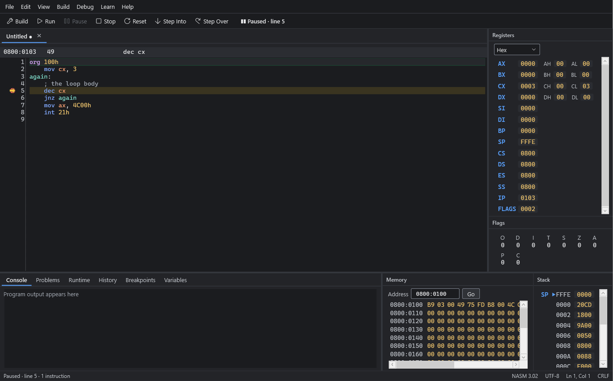
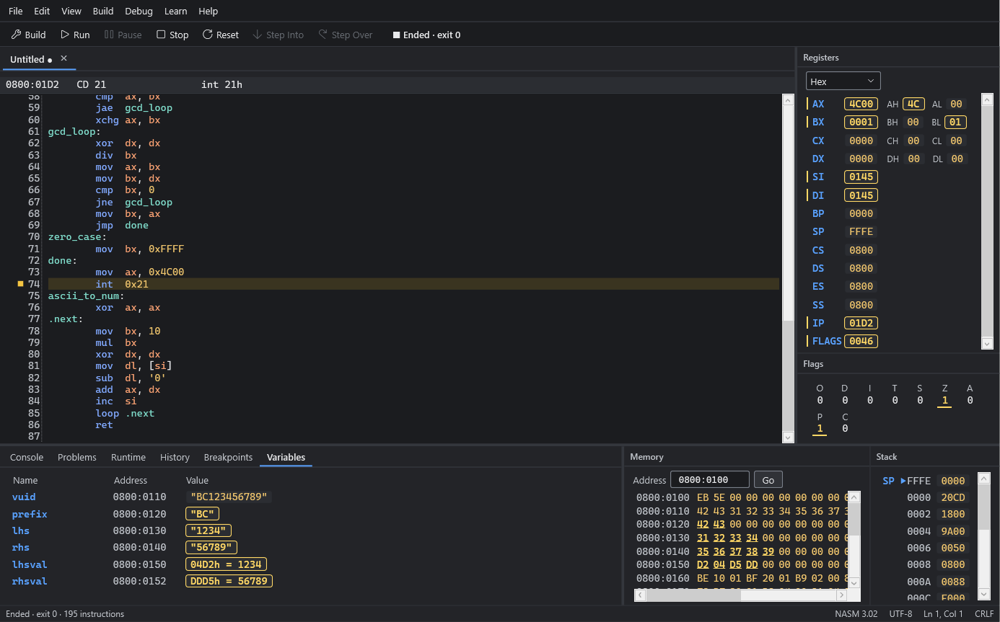

# Assembly Studio

**Write, build, run and debug 8086 assembly programs, in one window, fully offline.**

Assembly Studio is a free, open-source Windows IDE for learning assembly language. Write a DOS `.COM` program in NASM syntax, build
it with the bundled NASM, run it on an emulated 8086 PC, then step through it while registers, flags, memory, the stack and your
variables update, with every change marked.

[](https://github.com/Ahmad4085/assembly-studio/releases/latest)
[](LICENSE)




## Download
Get **`AssemblyStudio-1.0.0-setup.exe`** from the [latest release](https://github.com/Ahmad4085/assembly-studio/releases/latest).

- **SHA-256:** `16ac15358b80d2d12425be5ed05bce5e89dbf2a453514cd5dfaa8ce7153f3d83`
- **No administrator rights needed.** It installs for your Windows account and downloads nothing. The .NET runtime and NASM 3.02
  are included.
- **The installer is not code-signed,** so Windows SmartScreen may warn you. Choose **More info**, then **Run anyway**. See the
  [install guide](docs/09-release/install-guide.md).

## Features
- **Editor:**
  - NASM syntax highlighting, line numbers, the current line marked;
  - undo and redo, block indent;
  - find and replace, go to line, zoom;
  - tabs, recent files, and recovery of unsaved edits after a crash.
- **Build with one key:**
  - errors and warnings appear on their source lines, each with a plain next step;
  - a hint when the code looks like MASM or TASM.
- **Run safely:**
  - programs run inside an emulated 8086 (1 MB, real mode) and can never touch your files or network;
  - an instruction budget pauses endless loops, and the IDE never freezes.
- **Debug:**
  - Step Into, Step Over, breakpoints;
  - the current instruction with its disassembly, and an execution history.
- **See inside the machine:**
  - registers (with their 8-bit halves) in hex, decimal or binary;
  - flags, memory (hex and ASCII) and the stack;
  - a **Variables** panel that lists your program's data labels with their values.
- **DOS text services:** INT 21h functions 00h, 01h, 02h, 07h, 08h, 09h, 0Ah and 4Ch, INT 20h and Ctrl-C, with a console that
  accepts keyboard input.
- **Learn:** 8 sample programs, 5 tutorials, an instruction and concept reference, and help pages, all offline.
- **Accessible:**
  - every workflow by keyboard, with a visible focus;
  - screen-reader names and announcements;
  - dark, light and high-contrast themes.



## Quick start
1. Install and start **Assembly Studio**.
2. Open the **Learn** sidebar (View → Learn Sidebar, or **Ctrl+Alt+L**) and choose the sample **Hello, World**.
3. Press **F5** to build and run it. The output appears in the Console panel.
4. Press **F11** to step one instruction at a time and watch the registers change.

The **Hello, World** sample:

```nasm
org 100h                    ; a .COM program starts at offset 100h

    mov dx, message         ; DS:DX = address of the text
    mov ah, 09h             ; DOS function 09h: print text up to the '$'
    int 21h

    mov ax, 4C00h           ; DOS function 4Ch: end the program, exit code 0 (AL)
    int 21h

message db 'Hello, World!', 13, 10, '$'   ; 13, 10 = carriage return, line feed
```

| Key | Action |
|---|---|
| Ctrl+Shift+B | Build |
| F5 | Run / Continue |
| F11 / F10 | Step Into / Step Over |
| F9 | Toggle breakpoint |

## What is supported
- **Processor:** Intel 8086, real mode. Every documented 8086 instruction except IN, OUT and the 8087 (ESC) instructions.
- **Programs:** DOS `.COM` programs of up to 65,278 bytes, in NASM syntax.
- **Services:** the DOS text functions above. No files, disks, clock or BIOS services (INT 10h, INT 16h).
- **Windows:** 64-bit Windows 11, or Windows 10 21H2 or later. Release 1.0.0 was tested on Windows 11.

See the [known limitations](docs/09-release/known-limitations.md) and the [release notes](docs/09-release/release-notes-1.0.0.md).

## Build from source
**You need:** Windows 10 or 11 x64, the [.NET SDK 10.0.403](https://dotnet.microsoft.com/download) (pinned in `global.json`) and
PowerShell.

```powershell
git clone https://github.com/Ahmad4085/assembly-studio.git
cd assembly-studio
powershell -ExecutionPolicy Bypass -File build/fetch-nasm.ps1           # NASM 3.02, checked against its SHA-256
dotnet build AssemblyStudio.slnx -c Release
dotnet run --project src/AssemblyStudio.App -c Release
```

**Tests:**
```powershell
powershell -ExecutionPolicy Bypass -File build/fetch-singlesteptests.ps1   # 8086 hardware test data for the engine tests
powershell -ExecutionPolicy Bypass -File build/test.ps1                    # the whole suite
```

**Installer:**
```powershell
powershell -ExecutionPolicy Bypass -File build/fetch-innosetup.ps1
powershell -ExecutionPolicy Bypass -File build/installer/build-installer.ps1
```

`build-installer.ps1` also regenerates the third-party notices, the license inventory and the SBOM from the published files.

## How it is built
- **Platform:** C# on .NET 10, WPF with MVVM, and [AvalonEdit](https://github.com/icsharpcode/AvalonEdit) for the editor.
- **Execution:** a custom 8086 core, checked against hardware test data
  ([SingleStepTests](https://github.com/SingleStepTests/8086)).
- **Assembler:** the bundled [NASM](https://www.nasm.us/).

The parts are separate projects behind interfaces:

| Project | Role |
|---|---|
| `AssemblyStudio.Engine.I8086` | The CPU |
| `AssemblyStudio.Runtime` | Memory, the loader, interrupts |
| `AssemblyStudio.Os.Dos` | DOS services |
| `AssemblyStudio.Toolchain.Nasm` | NASM integration and source mapping |
| `AssemblyStudio.Debugging` | Debug sessions |
| `AssemblyStudio.Content` | Samples, tutorials and help |
| `AssemblyStudio.App` | The WPF user interface |

**A rule throughout:** the panels only ever show state produced by the real engine, never invented values.

The project follows a documentation-driven, phase-gated process:
- requirements, architecture decisions (ADRs), design, plan, test and QA reports are all in [`docs/`](docs);
- the rules for contributors and AI coding agents are in [`AGENTS.md`](AGENTS.md).

## License
Assembly Studio is released under the [MIT License](LICENSE). It includes:
- the Microsoft .NET runtime and WPF;
- AvalonEdit, CommunityToolkit.Mvvm and Iced;
- NASM 3.02.

Their licenses are listed in [`THIRD-PARTY-NOTICES.txt`](THIRD-PARTY-NOTICES.txt) and in the app under Help → About. Six .NET
runtime files are under Microsoft's terms, which you accept in the installer.
