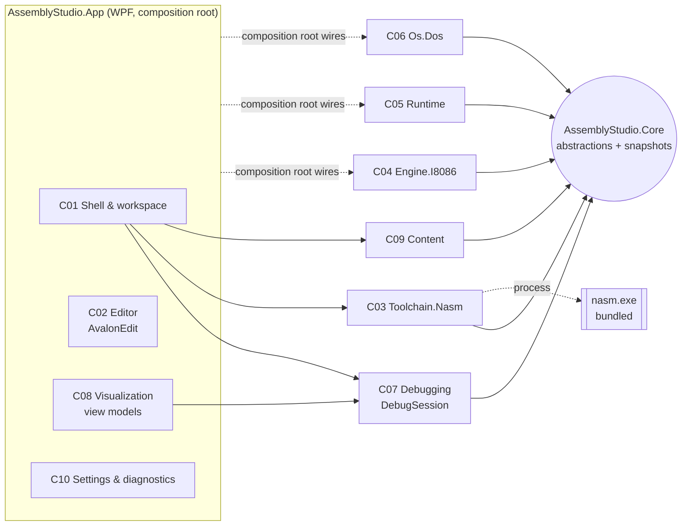

# Assembly Studio — System Architecture

| Field | Value |
|---|---|
| Document | System architecture |
| Status | Approved |
| Version | 1.1 |
| Last updated | 2026-10-26 |
| Depends on | `docs/01-requirements/` set v2.0, `docs/02-research/research-summary.md` v1.0, `poc-001.md`, `poc-002.md` |

## 1. Context and goals
Assembly Studio assembles NASM-syntax 8086 `.COM` programs with a bundled NASM, runs them **only** inside an emulated 8086
machine with a small DOS service layer, and lets learners step through them while seeing true machine state. It runs on Windows 11
24H2+ and Windows 10 Enterprise LTSC 21H2, x64 (D-011), entirely offline.

**Quality attributes that drive the design** (from the NFRs):

| Driver | NFRs | Design response |
|---|---|---|
| Truthful state | NFR-018, NFR-016 | Immutable snapshots produced only by the engine. Deterministic machine (ADR-0003, ADR-0007) |
| Replaceable engine | NFR-019 | `Core` abstractions. Concrete engine wired only in the composition root (ADR-0002) |
| Never freeze, never crash | NFR-004, NFR-010, FR-067, FR-096 | Engine on a worker thread, per-instruction cancellation, budget, fault containment (ADR-0004, ADR-0007) |
| Exact 8086 behavior | NFR-017, FR-036 | Custom core validated per opcode against SingleStepTests hardware data (ADR-0003) |
| Offline and private | NFR-008, NFR-009, CON-002 | No network code paths. Bundled NASM and content. Local settings and logs (ADR-0005, ADR-0007, ADR-0009) |
| Safe tool execution | NFR-014, NFR-013 | Shell-free, sandboxed NASM invocation. Guest code confined to the emulator (ADR-0004, ADR-0005) |

**Measured baselines** (dev machine i5-8265U, POC-001/002): step + snapshot 0.091 µs mean; 47.7–49.4 M instructions/s;
NASM build 66–83 ms and `nasm -E` 62–67 ms per run [Measured].

## 2. Component overview

Dependencies point **toward `Core`**. Only `App` references WPF and AvalonEdit, and only its composition root references concrete
engine, runtime and OS types (ADR-0002). C11 (packaging) and C12 (build and test infrastructure) are build-time components.

| ID | Component | Responsibility | Must NOT do | Public interface (in `Core` unless noted) | Project | ADR |
|---|---|---|---|---|---|---|
| C01 | Shell & workspace | Main window, tabs, file open/save (atomic), unsaved prompts, recent files, panes, commands, keyboard map, messages | Execute or decode instructions. Read live engine state | (App) `IDocumentService`, `ICommandService` | App | 0007 |
| C02 | Editor | NASM highlighting, line numbers, editing, find/replace, go to line, diagnostics markers, breakpoint and current-line margins, zoom | Know about CPU or DOS semantics | (App) `EditorViewModel` + AvalonEdit adapters | App | 0006 |
| C03 | Assembler integration | Locate and version-check NASM. Sandboxed invocation. CPU-directive guard. Diagnostics. Listing/map → source map | Execute code. Invoke via a shell | `IAssembler`, `BuildResult`, `Diagnostic`, `ISourceMap` | Toolchain.Nasm | 0005 |
| C04 | CPU engine | 8086 decode and execute, flags (with undefined mask), real interrupt semantics, interception callback, unsupported-opcode halt | Know about UI, DOS or files. Expose mutable state | `ICpu`, `CpuState`, `IInterruptRouter` (callback), `IDisassembler` | Engine.I8086 | 0003 |
| C05 | Runtime environment | 1 MiB memory with write journal. .COM loader and PSP. IVT stubs. Interrupt routing. Console device. CPU exception policy | Implement DOS function semantics. Touch host files or network | `IMachine`, `IMemory`, `IConsoleDevice`, `StepResult` | Runtime | 0004 |
| C06 | OS services (DOS) | INT 21h 00/01/02/07/08/09/0A/4C and INT 20h with DOS 3.3/4.0 semantics and documented deviations. Ctrl-C/INT 23h | Access the host (files, devices, clock, network) | `IOsServices` | Os.Dos | 0004 |
| C07 | Debugger / session control | Worker thread. Run/Pause/Stop/Reset/Step Into/Step Over. Breakpoints. Budget. History. Input recording. Snapshot publishing | Touch WPF. Fabricate state | `IDebugSession`, `MachineSnapshot`, `SessionState` | Debugging | 0007 |
| C08 | Visualization | Registers, flags (incl. undefined), memory, stack, current instruction, history, console views. Change highlighting. Number formats | Show anything not taken from a snapshot | (App) view models | App | 0007 |
| C09 | Learning content | Samples (each test-verified), tutorials, instruction reference, help/limitations | Make claims contradicting tested engine behavior | `IContentCatalog` | Content | 0002 |
| C10 | Settings & diagnostics | Settings persistence and recovery, assembler path, preferences, About/diagnostics, local log | Send data off the machine | (App) `ISettingsService` | App | 0007 |
| C11 | Packaging & installer | Self-contained publish, Inno Setup per-user installer, notices, SBOM | Download anything at install time | build scripts | build/installer | 0009 |
| C12 | Build & test infrastructure | Solution settings, analyzers, `global.json` (MTP), test projects, oracle data fetch, coverage, architecture checks | Ship test data or tools in the product | build scripts | build, tests | 0008 |

The complete requirement → component → ADR allocation is in **Appendix A** (generated and checked: every P0/P1 FR/NFR is covered).

## 3. Key flows
1. **Edit → assemble.** C02 edits text. Build (C01) passes the document to C03:
   - `nasm -E` CPU guard;
   - `nasm -f bin …` with listing and map in a temp directory;
   - `BuildResult` returned with diagnostics, image and `ISourceMap`;
   - diagnostics go to the pane and the editor markers (FR-018, FR-029).
   A failed build has no map, so debugging is disabled.
2. **Load.** C07 asks C05 to load the image: PSP at 0800h, image at PSP:0100h, initial registers per ADR-0004. The initial
   snapshot is published (AC-021).
3. **Step.** UI command → channel → C07 worker. C04 executes one instruction. The snapshot (CPU state, undefined mask, memory
   changes from the journal, console delta, source location via `ISourceMap`) is published immediately. C08 diffs it with the
   previous snapshot for highlighting (FR-049, FR-056).
4. **Run.** The worker loops instruction by instruction. Before each one it checks pause/stop, breakpoints (the address of the
   breakpointed line's first byte, via `ISourceMap`) and the budget. While running it publishes at most 30 Hz with state "running".
   It stops on breakpoint, pause, termination, fault or budget (FR-051, FR-042, FR-057).
5. **Interrupt.** C04 meets `INT n` and calls the C05 router:
   - default vector + DOS service → C06 handles it and returns a `StepResult`;
   - program-installed vector → normal vectoring;
   - unsupported function → `Halted(Unsupported)`;
   - input needed and queue empty → `WaitingForInput` (CS:IP stays on the INT instruction).
6. **Input.** A console keystroke goes to the C05 queue (recorded) and the session resumes (FR-064).
7. **Terminate / fault.** The session ends with the termination path and exit code, or halts with an error that keeps the state
   inspectable (FR-037, FR-038, FR-041).

## 4. Execution model and state
- **Threads:** the UI thread, plus one worker thread per debug session. NASM runs as a child process awaited asynchronously. No
  engine code runs on the UI thread (FR-067).
- **Ownership:** the worker owns the `IMachine`. Other threads communicate only through commands (in) and immutable snapshots (out).
- **Cancellation:** checked before every instruction. At about 48 M instructions/s the worst-case reaction is far below the
  500 ms target (NFR-004).
- **Limits:** instruction budget (default 10,000,000, configurable), console buffer 1 MB, history 1,000 entries, memory exactly
  1 MiB (NFR-015).
- **Determinism:** no wall clock, no randomness, input recorded with instruction counts. Same image + same input = same trace (NFR-016).
- **Snapshots:** `CpuState` (record struct) plus memory change ranges from the write journal, and (ADR-0007 v1.1) the decoded current
  instruction, subscribed memory windows, the stack window and the history delta. The full 1 MiB isn't copied per step
  (161 µs, measured). Reverse stepping (P2) will replay the journal.

## 5. Data and file formats
| Data | Format and location |
|---|---|
| User source | Plain text files anywhere. Encoding and line endings preserved (FR-019/020) |
| Build artifacts | Per-build temp directory under `%TEMP%\AssemblyStudio\build-*` (`.com`, `.lst`, `.map`), deleted after the session |
| Settings | `%APPDATA%\AssemblyStudio\settings.json` (System.Text.Json). Invalid → defaults + renamed backup |
| Logs | `%LOCALAPPDATA%\AssemblyStudio\logs\*.log`, rolling, ≤ 10 MB |
| Recovery | `%LOCALAPPDATA%\AssemblyStudio\recovery\` autosave every ≤ 60 s for unsaved documents (NFR-011) |
| Content | Embedded resources in `AssemblyStudio.Content` (samples, tutorials, reference). Read-only |
| No project files | Single-file programs in the MVP (FR-010 is P2) |

## 6. Error handling
| Error | Detected by | Result |
|---|---|---|
| Assembler missing or invalid | C03 version check | Build not attempted. Message + link to Settings (FR-030, AC-016) |
| Assembler timeout or crash | C03 process supervision | Build fails with a specific reason. Next build works (FR-095, AC-019) |
| Source errors | C03 diagnostics parser | Diagnostics pane + editor markers. Debug disabled (FR-018, AC-013) |
| Non-8086 CPU directive | C03 `nasm -E` guard | Build error at the directive line (FR-027) |
| Image > 65,280 bytes | C03 | Build error stating the .COM limit (FR-031) |
| Unsupported or undocumented opcode | C04 | `Halted(Unsupported)`: CS:IP, bytes, reason. State inspectable (FR-037) |
| CPU exception, default vector | C05 router | `Halted(RuntimeError)`: divide error, overflow and so on (FR-038) |
| Unsupported INT/function | C05/C06 | `Halted(UnsupportedService)` naming INT and AH (FR-040) |
| Budget exceeded | C07 | Paused with message. User may continue or stop (FR-042) |
| Engine bug (exception) | C07 boundary | Session error state. Logged locally. IDE stays usable (NFR-010) |
| File I/O errors | C01 document service | Specific message. In-memory content kept. Atomic save (FR-008, NFR-029) |
| Corrupt settings | C10 | Defaults + backup + notice (FR-081) |

User-facing messages carry a stable code, what happened, where, and the next step (FR-066, NFR-024).

## 7. Security boundaries
- **Guest programs:** run only in C04/C05. Host access exists only through C06, which offers none (no files, devices or network).
  Unsupported services halt. Memory is a 1 MiB array, so guest addresses can't reach host memory (NFR-013).
- **External process:** NASM only. Absolute path to the bundled or configured binary (never a silent `PATH` lookup), `ArgumentList`,
  no shell, a per-build temp directory, a timeout with tree kill, an output cap (NFR-014).
- **Files:** user-chosen paths only. Paths are validated and saves are atomic. Content is read-only.
- **Network:** none in any core path (NFR-008/009). Verified by test with a network monitor (AC-034).

## 8. Performance requirements and budgets
| NFR | Budget | Evidence so far |
|---|---|---|
| NFR-002 step ≤ 100 ms | Engine + snapshot < 1 ms. The rest is the UI render budget | 0.091 µs engine step + snapshot [Measured, POC-001] |
| NFR-003 ≥ 1 M instr/s | Engine ≥ 10 M instr/s with UI publishing at 30 Hz | 47.7–49.4 M instr/s (subset) [Measured] |
| NFR-004 UI block ≤ 100 ms, Pause ≤ 500 ms | Per-instruction cancellation. Publishing throttled | Design. Verified by AC-030 |
| NFR-006 build ≤ 2 s | NASM ≈ 140 ms (guard + build) + parsing | [Measured, POC-002] |
| NFR-001, NFR-005, NFR-007 | Measured in their implementation tasks | Not yet measured |

**Reference machine (OQ-014), approved 2026-10-26 18:54 +0500 (D-014):** the dev machine (Intel Core i5-8265U, 4C/8T, 16 GB, Windows 11) is the
**minimum reference** for performance acceptance (AC-056).

## 9. Extensibility path
- **Other CPUs** (80186 → 386 → x86-64): new `Engine.*` projects implementing `ICpu`. **Risk:** `CpuState` and the `IMemory` address
  width are 8086-shaped. A generalized register and address model is required before 32-bit work, and is planned as an ADR at that time.
- **More OS services:** BIOS INT 10h/16h (FR-044) as another `IOsServices`. The router already distinguishes default and program vectors.
- **Executable formats:** an MZ loader in C05 (FR-043), using NASM's `exebin.mac` route (no linker).
- **Assemblers:** `IAssembler` lets another assembler implementation exist (D-006 currently fixes NASM syntax).

## 10. Testing strategy
| Level | Scope | Tooling |
|---|---|---|
| Engine unit | Every opcode family vs SingleStepTests 8086 (100%) + hand spec tests | xUnit v3, pinned oracle data (ADR-0008) |
| Runtime/DOS unit | Loader initial state. Each DOS function (return values, echo, Ctrl-C, 0Ah editing). Router decisions | xUnit v3 |
| Toolchain integration | POC-002 fixtures + 3 independent verifiers. Diagnostics. Guard. Timeout | xUnit v3 + bundled NASM |
| Program-level | NASM source → load → run with scripted input → output, exit path, trace (samples, AC-022/023/064/047) | xUnit v3 |
| Session | Pause latency, breakpoints, step over, budget, fault containment, soak/fuzz | xUnit v3 (headless) |
| View model | Displayed values equal snapshot values. Highlighting. Formats | xUnit v3 |
| UI smoke | Keyboard-only flow, UIA names (AC-043/044) | FlaUI.UIA3 |
| Manual / QA | Narrator, high contrast, DPI, clean-VM install, offline | QA checklists |
| Architecture | No WPF references outside App. Dependency graph per ADR-0002 | Test or build check |

## 11. Decisions
| ADR | Title | Status |
|---|---|---|
| ADR-0001 | Platform: .NET 10 LTS + WPF on Windows x64 | Approved |
| ADR-0002 | Solution structure and dependency rules | Approved |
| ADR-0003 | Execution engine: custom managed 8086 core | Approved |
| ADR-0004 | Runtime environment and DOS services: in-process, own implementation | Approved |
| ADR-0005 | Assembler integration: bundled NASM 3.02, listing + map source mapping | Approved |
| ADR-0006 | Code editor: AvalonEdit | Approved |
| ADR-0007 | UI architecture: MVVM, threading, snapshots, settings (v1.1 amendment) | Approved |
| ADR-0008 | Test framework, tools and oracle data | Approved |
| ADR-0009 | Packaging: self-contained publish + Inno Setup per-user installer | Approved (code signing Deferred) |

## 12. Risks and open questions
| ID | Description | Impact | Mitigation / validation |
|---|---|---|---|
| RISK-001 | NASM listing format is undocumented and may change between versions | High | Pin NASM 3.02. POC-002 fixtures as regression tests. Upgrades are planned tasks (ADR-0005) |
| RISK-002 | AvalonEdit: no released net10 build. Basic screen-reader support | Medium | Validate in the first editor task. AvalonEditB fallback. Accessibility work planned (ADR-0006) |
| RISK-003 | An emulator defect crashes the in-process host | Medium | No recursion or unbounded allocation in the engine. Session-boundary catch. Fuzz/soak (ADR-0004) |
| RISK-004 | `Core` state model is 8086-shaped and blocks 32/64-bit later | Medium (post-MVP) | Generalization ADR before any 32-bit work (§9) |
| RISK-005 | FlaUI release cadence | Low | Keep UI tests few. Manual QA checklists |
| RISK-006 | Unsigned installer triggers SmartScreen warnings | Medium | Signing deferred to release (OQ-020). Documented in the install guide |
| OQ-007 | Specific permissive license (MIT vs Apache-2.0) not chosen | High (release) | User decision before the first release. Affects NOTICE handling |
| OQ-014 | Reference machine | — | **Resolved** by D-014 (§8) |
| OQ-021 | Ctrl+C in the console vs copy | Low | Design phase |
| OQ-022 | DOS 06h/0Bh/30h | Medium | Not in MVP (ADR-0004). Post-MVP requirement change if wanted |

## Appendix A. Requirement allocation
<!-- ALLOCATION:BEGIN -->
Generated from the component allocation and the ADRs' "Requirements addressed" rows. Check: every P0/P1 FR/NFR has ≥1 component.

| Requirement | Priority | Components | ADRs |
|---|---|---|---|
| FR-001 | P0 | C01 Shell & workspace | ADR-0007 |
| FR-002 | P0 | C01 Shell & workspace | ADR-0007 |
| FR-003 | P0 | C01 Shell & workspace | ADR-0007 |
| FR-004 | P0 | C01 Shell & workspace | ADR-0007 |
| FR-005 | P0 | C01 Shell & workspace | ADR-0007 |
| FR-006 | P1 | C01 Shell & workspace | ADR-0007 |
| FR-007 | P1 | C01 Shell & workspace | ADR-0007 |
| FR-008 | P0 | C01 Shell & workspace | ADR-0007 |
| FR-009 | P2 | C01 Shell & workspace | ADR-0007 |
| FR-010 | P2 | C01 Shell & workspace, C03 Assembler integration | ADR-0005, ADR-0007 |
| FR-011 | P0 | C02 Editor | ADR-0006 |
| FR-012 | P0 | C02 Editor | ADR-0006 |
| FR-013 | P0 | C02 Editor | ADR-0006 |
| FR-014 | P1 | C02 Editor | ADR-0006 |
| FR-015 | P0 | C02 Editor | ADR-0006 |
| FR-016 | P1 | C02 Editor | ADR-0006 |
| FR-017 | P1 | C02 Editor | ADR-0006 |
| FR-018 | P0 | C02 Editor | ADR-0006 |
| FR-019 | P1 | C01 Shell & workspace, C02 Editor | ADR-0006, ADR-0007 |
| FR-020 | P1 | C01 Shell & workspace, C02 Editor | ADR-0006, ADR-0007 |
| FR-021 | P1 | C03 Assembler integration, C02 Editor | ADR-0005, ADR-0006 |
| FR-022 | P1 | C02 Editor, C08 Visualization | ADR-0006, ADR-0007 |
| FR-023 | P0 | C03 Assembler integration | ADR-0005 |
| FR-024 | P0 | C03 Assembler integration, C10 Settings & diagnostics | ADR-0005, ADR-0007 |
| FR-025 | P0 | C03 Assembler integration | ADR-0005 |
| FR-026 | P0 | C03 Assembler integration | ADR-0005 |
| FR-027 | P0 | C03 Assembler integration | ADR-0005 |
| FR-028 | P0 | C03 Assembler integration | ADR-0005 |
| FR-029 | P0 | C03 Assembler integration | ADR-0005 |
| FR-030 | P0 | C03 Assembler integration | ADR-0005 |
| FR-031 | P0 | C03 Assembler integration | ADR-0005 |
| FR-032 | P1 | C09 Learning content, C03 Assembler integration | ADR-0002, ADR-0005 |
| FR-033 | P0 | C04 CPU engine, C05 Runtime environment | ADR-0002, ADR-0003, ADR-0004 |
| FR-034 | P0 | C05 Runtime environment | ADR-0004 |
| FR-035 | P0 | C07 Debugger / session | ADR-0007 |
| FR-036 | P0 | C04 CPU engine | ADR-0003 |
| FR-037 | P0 | C04 CPU engine, C07 Debugger / session | ADR-0003, ADR-0007 |
| FR-038 | P0 | C04 CPU engine, C05 Runtime environment | ADR-0003, ADR-0004 |
| FR-039 | P0 | C06 OS services (DOS) | ADR-0004 |
| FR-040 | P0 | C05 Runtime environment, C06 OS services (DOS) | ADR-0004 |
| FR-041 | P0 | C05 Runtime environment, C06 OS services (DOS), C07 Debugger / session | ADR-0004, ADR-0007 |
| FR-042 | P0 | C07 Debugger / session | ADR-0004, ADR-0007 |
| FR-043 | P2 | C05 Runtime environment | ADR-0004 |
| FR-044 | P2 | C06 OS services (DOS) | ADR-0004 |
| FR-045 | P0 | C09 Learning content | ADR-0002 |
| FR-046 | P0 | C08 Visualization | ADR-0003, ADR-0007 |
| FR-047 | P1 | C08 Visualization | ADR-0007 |
| FR-048 | P0 | C08 Visualization, C04 CPU engine | ADR-0003, ADR-0007 |
| FR-049 | P0 | C07 Debugger / session | ADR-0003, ADR-0007 |
| FR-050 | P1 | C07 Debugger / session | ADR-0007 |
| FR-051 | P0 | C07 Debugger / session | ADR-0007 |
| FR-052 | P1 | C07 Debugger / session, C02 Editor | ADR-0005, ADR-0006, ADR-0007 |
| FR-053 | P0 | C07 Debugger / session, C08 Visualization, C03 Assembler integration | ADR-0003, ADR-0005, ADR-0006, ADR-0007 |
| FR-054 | P0 | C08 Visualization | ADR-0007 |
| FR-055 | P0 | C08 Visualization | ADR-0007 |
| FR-056 | P0 | C08 Visualization, C05 Runtime environment | ADR-0003, ADR-0004, ADR-0007 |
| FR-057 | P1 | C07 Debugger / session, C08 Visualization | ADR-0007 |
| FR-058 | P1 | C07 Debugger / session, C08 Visualization | ADR-0003, ADR-0007 |
| FR-059 | P2 | C05 Runtime environment | ADR-0004 |
| FR-060 | P2 | C07 Debugger / session, C05 Runtime environment | ADR-0003, ADR-0004, ADR-0007 |
| FR-061 | P2 | C07 Debugger / session | ADR-0007 |
| FR-062 | P2 | C07 Debugger / session, C08 Visualization | ADR-0007 |
| FR-063 | P0 | C05 Runtime environment, C08 Visualization | ADR-0004, ADR-0007 |
| FR-064 | P0 | C05 Runtime environment, C06 OS services (DOS), C08 Visualization | ADR-0004, ADR-0007 |
| FR-065 | P0 | C01 Shell & workspace, C08 Visualization | ADR-0007 |
| FR-066 | P1 | C01 Shell & workspace, C03 Assembler integration, C07 Debugger / session | ADR-0005, ADR-0007 |
| FR-067 | P0 | C07 Debugger / session, C01 Shell & workspace | ADR-0007 |
| FR-068 | P0 | C09 Learning content | ADR-0002, ADR-0008 |
| FR-069 | P1 | C09 Learning content, C01 Shell & workspace | ADR-0002, ADR-0007 |
| FR-070 | P1 | C09 Learning content, C08 Visualization | ADR-0002, ADR-0007 |
| FR-071 | P1 | C09 Learning content, C08 Visualization | ADR-0002, ADR-0007 |
| FR-072 | P0 | C09 Learning content, C08 Visualization | ADR-0002, ADR-0007 |
| FR-073 | P2 | C09 Learning content | ADR-0002 |
| FR-074 | P2 | C01 Shell & workspace | ADR-0007 |
| FR-075 | P0 | C10 Settings & diagnostics, C03 Assembler integration | ADR-0005, ADR-0007 |
| FR-076 | P0 | C10 Settings & diagnostics | ADR-0007 |
| FR-077 | P1 | C10 Settings & diagnostics | ADR-0007 |
| FR-078 | P1 | C10 Settings & diagnostics | ADR-0007 |
| FR-079 | P0 | C10 Settings & diagnostics, C11 Packaging & installer | ADR-0007, ADR-0009 |
| FR-080 | P0 | C10 Settings & diagnostics | ADR-0007 |
| FR-081 | P0 | C10 Settings & diagnostics | ADR-0007 |
| FR-082 | P1 | C10 Settings & diagnostics | ADR-0007 |
| FR-083 | P0 | C11 Packaging & installer | ADR-0001, ADR-0009 |
| FR-084 | P1 | C11 Packaging & installer | ADR-0009 |
| FR-085 | P0 | C11 Packaging & installer | ADR-0009 |
| FR-086 | P0 | C11 Packaging & installer | ADR-0001, ADR-0009 |
| FR-087 | P0 | C10 Settings & diagnostics, C11 Packaging & installer | ADR-0007, ADR-0009 |
| FR-088 | P1 | C11 Packaging & installer | ADR-0009 |
| FR-089 | P3 | C11 Packaging & installer | ADR-0009 |
| FR-090 | P0 | C11 Packaging & installer, C10 Settings & diagnostics | ADR-0007, ADR-0009 |
| FR-091 | P0 | C01 Shell & workspace, C02 Editor, C08 Visualization | ADR-0006, ADR-0007 |
| FR-092 | P0 | C01 Shell & workspace, C02 Editor, C08 Visualization | ADR-0006, ADR-0007 |
| FR-093 | P1 | C01 Shell & workspace, C02 Editor, C08 Visualization | ADR-0006, ADR-0007 |
| FR-094 | P1 | C01 Shell & workspace, C02 Editor, C08 Visualization | ADR-0006, ADR-0007 |
| FR-095 | P0 | C03 Assembler integration, C07 Debugger / session, C01 Shell & workspace | ADR-0005, ADR-0007 |
| FR-096 | P0 | C04 CPU engine, C05 Runtime environment, C07 Debugger / session | ADR-0003, ADR-0004, ADR-0007 |
| NFR-001 | P1 | C02 Editor | ADR-0006 |
| NFR-002 | P0 | C07 Debugger / session, C08 Visualization | ADR-0003, ADR-0007 |
| NFR-003 | P1 | C04 CPU engine | ADR-0003 |
| NFR-004 | P0 | C07 Debugger / session, C01 Shell & workspace | ADR-0007 |
| NFR-005 | P1 | C01 Shell & workspace | ADR-0007 |
| NFR-006 | P1 | C03 Assembler integration | ADR-0005 |
| NFR-007 | P1 | C07 Debugger / session, C05 Runtime environment | ADR-0004, ADR-0007 |
| NFR-008 | P0 | C01 Shell & workspace, C03 Assembler integration, C11 Packaging & installer | ADR-0001, ADR-0005, ADR-0007, ADR-0009 |
| NFR-009 | P0 | C10 Settings & diagnostics | ADR-0007 |
| NFR-010 | P0 | C07 Debugger / session, C03 Assembler integration | ADR-0004, ADR-0005, ADR-0007 |
| NFR-011 | P1 | C01 Shell & workspace | ADR-0007 |
| NFR-012 | P1 | C10 Settings & diagnostics | ADR-0007 |
| NFR-013 | P0 | C05 Runtime environment, C06 OS services (DOS) | ADR-0003, ADR-0004 |
| NFR-014 | P0 | C03 Assembler integration | ADR-0005 |
| NFR-015 | P0 | C05 Runtime environment, C07 Debugger / session | ADR-0004, ADR-0007 |
| NFR-016 | P0 | C04 CPU engine, C05 Runtime environment, C07 Debugger / session | ADR-0002, ADR-0003, ADR-0004, ADR-0007, ADR-0008 |
| NFR-017 | P0 | C04 CPU engine, C12 Build & test infrastructure | ADR-0003, ADR-0008 |
| NFR-018 | P0 | C07 Debugger / session, C08 Visualization | ADR-0007 |
| NFR-019 | P0 | C12 Build & test infrastructure | ADR-0002, ADR-0003, ADR-0007, ADR-0008 |
| NFR-020 | P0 | C12 Build & test infrastructure | ADR-0002, ADR-0008 |
| NFR-021 | P1 | C12 Build & test infrastructure | ADR-0002, ADR-0008 |
| NFR-022 | P0 | C01 Shell & workspace, C02 Editor, C08 Visualization | ADR-0006, ADR-0007, ADR-0008 |
| NFR-023 | P1 | C01 Shell & workspace, C09 Learning content | ADR-0002, ADR-0007 |
| NFR-024 | P1 | C01 Shell & workspace, C03 Assembler integration | ADR-0005, ADR-0007 |
| NFR-025 | P0 | C11 Packaging & installer | ADR-0001, ADR-0009 |
| NFR-026 | P1 | C01 Shell & workspace | ADR-0001, ADR-0007 |
| NFR-027 | P0 | C11 Packaging & installer | ADR-0009 |
| NFR-028 | P2 | C11 Packaging & installer | ADR-0009 |
| NFR-029 | P0 | C01 Shell & workspace | ADR-0007 |
| NFR-030 | P0 | C11 Packaging & installer | ADR-0001, ADR-0005, ADR-0009 |
| NFR-031 | P1 | C11 Packaging & installer, C12 Build & test infrastructure | ADR-0008, ADR-0009 |
| NFR-032 | P1 | C01 Shell & workspace | ADR-0007 |
| NFR-033 | P1 | C09 Learning content | ADR-0002 |
<!-- ALLOCATION:END -->

## Changelog
- 2026-10-26 v0.1: Initial architecture (SDLC-006).
- 2026-10-26 v1.0: **Approved** by the user (2026-10-26 18:54 +0500: "approve architecture v0.1 and ADR-0001..0009; reference machine OK").
- 2026-10-26 v1.1: Minor. Snapshot description aligned with the approved ADR-0007 v1.1 amendment (OQ-023).
